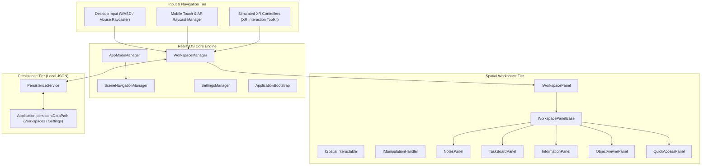

# RealityOS Architecture Documentation

## 1. System Overview & Philosophy

**RealityOS** is a multi-modal spatial computing environment engineered in Unity 6 that treats digital interfaces as first-class physical and spatial 3D objects rather than rigid 2D windows.

The architecture decouples **Input Interpretation** from **Spatial Manipulation** and **Workspace Data Persistence**, enabling identical floating panels to be manipulated seamlessly across three distinct interaction environments:
1. **Desktop Spatial Mode** – Mouse & keyboard navigation in a 3D workspace.
2. **Mobile Augmented Reality Mode** – Real-world plane detection and anchoring via AR Foundation & ARCore.
3. **Simulated Extended Reality Mode** – XR Interaction Toolkit ray selection, grabbing, and comfort locomotion simulated via keyboard/mouse.

---

## 2. High-Level Architectural Diagram



---

## 3. Core Subsystems

### 3.1. Application Core
- **`ApplicationBootstrap`**: Ensures singletons (`AppModeManager`, `SettingsManager`, `SceneNavigationManager`, `WorkspaceManager`) exist via `DontDestroyOnLoad` and transitions smoothly to `MainMenu`.
- **`AppModeManager`**: Tracks current mode (`DesktopSpatial`, `MobileAR`, `SimulatedXR`), validates hardware capabilities (detecting Windows Standalone vs Android ARCore), and fires events.
- **`SceneNavigationManager`**: Manages asynchronous scene loading across `Bootstrap`, `MainMenu`, `DesktopWorkspace`, `ARWorkspace`, `XRSimulator`, and `DemoWorkspace`.
- **`SettingsManager`**: Manages user configuration (camera speeds, look sensitivities, volume, graphics quality, snap turning) and saves to `settings.json`.

### 3.2. Spatial Workspace Engine
- **`WorkspaceManager`**: Owns the active `WorkspaceData` state, active panel registry, panel lifecycle (spawning, duplicating, deleting, focusing), auto-saving every 60s, and layout presets (3D Curved Arc, Horizontal Grid).
- **`WorkspacePanelBase`**: Implements `IWorkspacePanel`, `ISpatialInteractable`, and `IManipulationHandler`. Provides smooth kinematic interpolation (`Vector3.Lerp`, `Quaternion.Slerp`), selection outlines, header drag handles, and JSON import/export.

### 3.3. Shared Interaction Interfaces
```csharp
public interface ISpatialInteractable {
    bool IsSelected { get; }
    bool IsHovered { get; }
    void OnSelect();
    void OnDeselect();
    void OnHoverEnter();
    void OnHoverExit();
    Transform TransformTarget { get; }
}

public interface IManipulationHandler {
    ManipulationMode CurrentMode { get; }
    void BeginManipulation(ManipulationMode mode);
    void EndManipulation();
    void MoveTo(Vector3 worldPosition);
    void TranslateDelta(Vector3 deltaMovement);
    void RotateBy(Vector3 deltaEuler);
    void ScaleBy(float scaleMultiplier);
    void SetScale(Vector3 newScale);
}
```

### 3.4. Persistence Architecture
- Implemented in `PersistenceService` implementing `IWorkspacePersistence`.
- Workspaces are stored atomically in individual JSON files:
  `Application.persistentDataPath/RealityOS/Workspaces/{workspaceId}.json`.
- Automatic schema validation ensures null collections are defaulted, missing IDs are filled, and extreme scales are clamped to `[0.3, 5.0]`.
- Corrupt JSON triggers quarantine to `.corrupt.bak`, preventing application crashes.
- First launch auto-generates the "RealityOS Showcase Workspace" demonstrating all 5 panel types.

---

## 4. Hardware Optimization (Dell G15 / RTX 3050)
- **Draw Call Batching**: Dynamic batching and GPU instancing on panel materials.
- **Lighting**: Single Directional Light with soft shadows; unbaked real-time spatial grid.
- **Physics**: Lightweight BoxColliders only for raycast targeting; kinematic interpolation instead of costly physics engine solver updates on UI elements.
